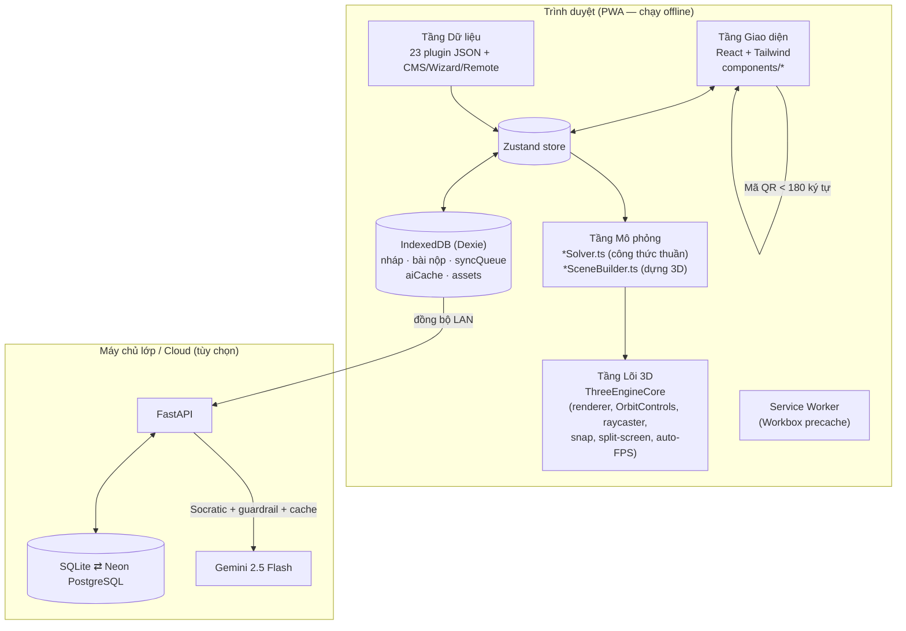
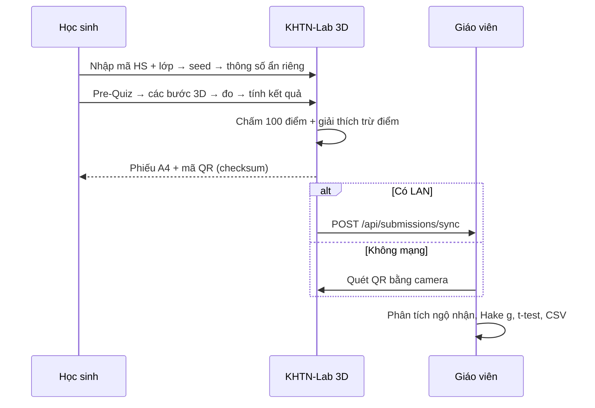

# Kiến trúc hệ thống & đối chiếu tiêu chí KHKT

## 1. Sơ đồ kiến trúc 4 tầng

## 2. Tính khoa học của mô phỏng
| Bài | Mô hình | Nguồn sai số mô phỏng |
|---|---|---|
| Bài 6 – Đo tốc độ (MC964) | v̄ = s/t, v = d/t; a = k·g·sinθ, k ≈ 5/7 | Gauss 0,4–0,8%; ĐCNN 0,001 s / 0,01 s; thước 1 mm |
| Bài 11 – Rơi tự do | g = 2s/t²; khảo sát được sai lệch khi cổng E đặt thấp | Gauss 0,8 ms; ĐCNN 0,001 s |
| Bài 22 – Tổng hợp lực | Quy tắc hình bình hành; d₁/d₂ = F₂/F₁ | Gauss 0,8%; lệch lực kế ẩn ±1,5% |
| Bài 30 – Va chạm | v = L/t; p = mv (mềm, đàn hồi) | Gauss 0,3%; hao hụt ẩn 0,4–2,2% |
| Định luật II Newton | a = F/(M+m), a = 2s/t² | Gauss 0,6% |
| Suất điện động | U = E − I·r; hồi quy tuyến tính | Gauss 0,3–0,4% đồng hồ |
| Thiosulfate | t = A/C·γ^(−ΔT/10) (Van't Hoff) | Gauss 2% |
| H₂O₂ | V = Vmax(1 − e^(−kt)), 24,79 L/mol | ±0,25 mL |
| Chuẩn độ KMnO₄ | 5Fe²⁺ + MnO₄⁻; C = 5·C·V/V | ĐCNN burette 0,05 mL, sai số thị sai |
| Enthalpy (tỏa/thu nhiệt) | Q = mcΔT; ΔH = −Q/n; ΔrH° từ ΔfH° | Thất thoát nhiệt ẩn 3–8% (sai số hệ thống) |
| Các yếu tố tốc độ | v̄ = \|ΔC\|/Δt; Van't Hoff; v ~ p³ (2NO + O₂) | Gauss 1,2% |
| Trao đổi chất qua màng | Khuếch tán ~ ΔC; bão hòa Vmax·C/(Km + C); thẩm thấu ~ (Ciso − C) | Gauss 0,6% thể tích |
| Truyền tin | R = 100·L/(Kd + L) | Gauss 2% |
| Protease, amylase | Mức thủy phân = k·t·f (4 điều kiện) | Gauss 1,5% |
| Vi sinh vật | Nt = N0·2ⁿ; 4 pha; nuôi cấy liên tục | 0,015 đơn vị lg |
| Tế bào | Kích thước thật = ảnh/K | 3–15% theo độ nét |
| Co nguyên sinh | f = logistic(C − C_đẳng trương); Ψs = −CRT | Nhị thức (đếm 50 tế bào) |
| Enzyme | Hoạt tính dạng chuông T, pH | Gauss 3% |
| Nguyên phân, giảm phân | Tỉ lệ = Σ phân chia / Σ tổng | Biến thiên ±12% giữa vi trường |

Mọi công thức được kiểm chứng tự động bằng Vitest (`client/src/engines/__tests__`), bao gồm chạy **quy trình chuẩn của 23 bài với 3 seed khác nhau** và yêu cầu kết quả nằm trong sai số cho phép.

## 3. Đối chiếu tiêu chí chấm KHKT
| Tiêu chí | Minh chứng trong sản phẩm |
|---|---|
| **Tính mới, sáng tạo** | Thông số ẩn theo seed từng HS (chống chép); nộp bài offline bằng QR có checksum; AI Socratic có guardrail + fallback offline; No-Code Wizard với bộ tính biểu thức an toàn; shader tế bào procedural 0 KB |
| **Tính khoa học** | Công thức chuẩn SGK KNTT 10, danh pháp IUPAC; nhiễu đo Gauss + lượng tử hóa theo ĐCNN; chấm hai lớp: xử lí số liệu (so với số liệu của chính HS) và độ chính xác thực nghiệm (so với giá trị thật); 88 unit test |
| **Hiệu quả & khả năng ứng dụng** | Đo bằng thực nghiệm sư phạm 10T1 (thực nghiệm) / 10T2 (đối chứng): Hake g, t-test Welch, Cohen's d, khảo sát Likert; phân tích ngộ nhận theo chương |
| **Khả năng triển khai thực tế** | PWA cài trên mọi thiết bị; gói JS lần tải đầu ≈ 365 KB gzip; tự hạ chất lượng khi FPS < 28; bản USB khoảng 1,7 MB chạy không cần cài đặt; máy chủ LAN SQLite; deploy miễn phí Vercel/Render/Neon |
| **Bảo trì & mở rộng** | Kiến trúc 4 tầng; plugin JSON; CMS/Wizard; gói cập nhật từ xa; CONTRIBUTING (thêm bài 11–12 trong 15 phút); Bug Snapshot; checklist PR |
| **An toàn & trợ năng** | Trang bị bảo hộ bắt buộc, giả lập sự cố; PIN SHA-256; cỡ chữ, chế độ mù màu, tương phản cao, giảm chuyển động, hỗ trợ bàn phím & trình đọc màn hình |

## 4. Đạo đức nghiên cứu
- Dữ liệu mẫu 80 HS trong ứng dụng là **mô phỏng** để minh họa quy trình phân tích, được đánh dấu rõ trên giao diện. Báo cáo dự thi phải dùng số liệu thật.
- Thu thập dữ liệu học sinh ở mức tối thiểu (mã HS, mã lớp); không thu thập thông tin cá nhân khác. Mã QR không chứa họ tên.
